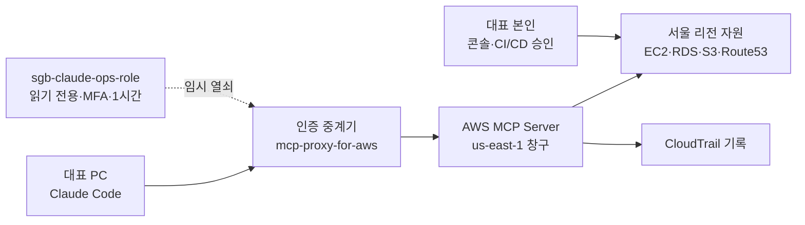

# 소개뱅크 AWS를 Claude에서 직접 관리하는 방법·절차서 v1.0

Sep 25, 2026 · @박세호

## 1. 최종 결론

**권장 방식: 사무실 PC의 Claude Code + AWS 공식 관리형 MCP 서버(AWS MCP Server) + Claude 전용 읽기 역할 `sgb-claude-ops-role`.** Claude는 조회·진단·명령 초안까지만 하고, 실제 변경은 대표가 콘솔 또는 기존 CI/CD 승인 단계에서 직접 실행합니다.

> **적용 금지 표시** — 이 문서는 절차 정리본입니다. 이 문서 작성 과정에서 AWS 계정·IAM·PC 설정은 하나도 바꾸지 않았습니다. 적용은 09-27 배포가 안정된 뒤 대표 결정으로 시작합니다.

판단 근거 세 가지:

1. AWS가 2026-05-06 관리형 MCP 서버를 정식 출시했고, Claude Code를 공식 지원 도구로 명시했습니다. ([AWS 발표](https://aws.amazon.com/blogs/aws/the-aws-mcp-server-is-now-generally-available/))
2. 이 서버를 거친 요청에는 식별 표시(조건 키)가 붙어, **사람은 변경 가능·Claude는 읽기만** 같은 분리를 IAM 정책 한 장으로 걸 수 있습니다. ([AWS IAM 문서](https://docs.aws.amazon.com/agent-toolkit/latest/userguide/security_iam_service-with-iam.html))
3. 모든 호출이 CloudTrail(행위 기록)에 남아 사후 점검이 가능합니다. 소개뱅크는 대표 1인 운영이라 "누가 무엇을 했는지" 기록이 특히 중요합니다.

휴대폰·웹의 Claude 채팅만으로는 현재 이 구성을 완성할 수 없습니다. 인증 중계 프로그램이 PC에서 돌아야 하기 때문입니다(3장 비교표 참고).

## 2. 용어 풀이

| 용어 | 쉬운 뜻 |
| --- | --- |
| MCP (모델 연결 규약) | Claude 같은 AI가 외부 서비스의 기능을 "도구"로 불러 쓰게 하는 표준 연결 방식 |
| AWS MCP Server | AWS가 직접 운영하는 MCP 창구. AWS 문서 검색과 AWS 명령 실행(`call_aws`), 격리된 파이썬 실행(`run_script`)을 제공 |
| mcp-proxy-for-aws (인증 중계기) | PC에서 돌며 내 AWS 자격 증명으로 서명해 AWS MCP Server에 요청을 넘겨 주는 공개 프로그램 |
| Claude Code | 명령창에서 쓰는 Claude. MCP 연결과 PC 명령 실행이 가능 |
| IAM 역할 (Role) | 사람 대신 "모자"처럼 잠깐 빌려 쓰는 권한 묶음. 임시 열쇠만 발급되어 유출 피해가 작음 |
| 최소 권한 | 일에 꼭 필요한 권한만 주는 원칙 |
| 조건 키 `aws:ViaAWSMCPService` | AWS MCP 서버를 거친 요청이면 참(true)이 되는 표시. 이 표시로 Claude 요청만 골라 막을 수 있음 |
| CloudTrail | AWS 계정에서 일어난 모든 조작의 기록부 |
| MFA (2단계 인증) | 비밀번호 외에 휴대폰 OTP 6자리를 한 번 더 요구하는 방식 |

## 3. 방식 비교 — 3가지

A안을 권장합니다. 권한 분리·기록·최신 문서 조회를 한 번에 얻고, 설치 부담이 가장 작습니다.

| 구분 | A. Claude Code + AWS MCP Server (권장) | B. Claude Code + AWS CLI 직접 실행 | C. Claude 앱 커넥터 "AWS MCP" |
| --- | --- | --- | --- |
| 작동 방식 | PC의 인증 중계기가 AWS 관리형 MCP 서버로 요청 전달 | Claude가 PC 명령창에서 `aws ...` 명령을 직접 실행 | Claude 커넥터 목록의 AWS MCP 항목 연결 |
| Claude 요청만 따로 제한 | 가능 (조건 키) | 불가 — 사람 명령과 구분 안 됨 | A와 같은 서버라면 가능 (추가 확인 필요) |
| 최신 AWS 문서 조회 | 가능, 인증 없이 | 불가 | 가능 추정 (추가 확인 필요) |
| 필요 설치 | Claude Code, uv, AWS CLI | Claude Code, AWS CLI | Claude Desktop 여부 추가 확인 필요 |
| 휴대폰에서 사용 | 불가 | 불가 | 추가 확인 필요 |
| 사고 위험 | 낮음 | 높음 — PC 관리자 키로 실행될 수 있음 | 확인 전 판단 불가 |
| 판정 | **채택** | 보조용(읽기 역할 임시키로만) | 보류 — 정식 문서 확인 후 재검토 |

- C안: Claude 커넥터 목록에 "AWS MCP" 항목이 있음을 2026-09-25에 조회했습니다. 휴대폰 앱에서 동작하는지, 인증 방식이 무엇인지는 확인할 수 없어 보류합니다.
- 운영 자동화(n8n·OpenClaw 자동화 서버)는 정해진 알림 업무용이고, 이 문서는 대표가 대화로 AWS를 조회하는 용도입니다. 둘은 역할이 겹치지 않습니다.

## 4. 전체 구조와 권한 계층

Claude는 1시간짜리 읽기 전용 임시 열쇠로만 AWS에 닿고, 변경 경로는 대표 손에만 있습니다.



관리형 서버의 창구는 현재 미국 동부·독일 프랑크푸르트 두 곳이지만, 호출 대상은 서울 리전으로 지정할 수 있습니다. ([AWS 발표](https://aws.amazon.com/blogs/aws/the-aws-mcp-server-is-now-generally-available/))

| 단계 | 할 수 있는 일 | 적용 시기 |
| --- | --- | --- |
| L0 문서 | AWS 공식 문서 검색·요약 (인증 불필요) | 1주차 |
| L1 조회 | EC2·RDS 상태, 경보, 비용, 보안그룹, DNS 레코드 조회 | 1주차 |
| L2 제한 변경 | 스테이징 EC2 재기동 등 되돌릴 수 있는 일부 작업 | 1개월 무사고 후 별도 결정 |
| L3 파괴·권한 변경 | 삭제, 종료, IAM, DNS 변경, 운영 DB | **Claude 경유 영구 금지** — 대표 직접 |

- L1에서도 고객 데이터는 보지 않습니다. S3 업로드 파일 내용, 운영 비밀값(`/sgb/prod/*`), DB 데이터는 막습니다(7장 정책).

## 5. 필요한 조건과 전제

아래 7가지가 갖춰져야 시작합니다. 하나라도 비면 6장으로 넘어가지 않습니다.

1. **09-27 운영 배포 완료·안정화** — 배포 주간에 권한 구조를 건드리지 않습니다.
2. **대표 IAM 관리자 사용자에 MFA 등록** — `AWS적용절차 v2.0` §4-6 기준.
3. **CloudTrail 관리 이벤트 기록 켜짐** — 서울 리전 포함 전 리전.
4. **예산 알림 작동** — `AWS적용절차 v2.0` §4-4.
5. **사무실 Windows PC 1대 지정** — Claude Code를 쓸 PC를 1대로 한정합니다.
6. **Claude Code 사용 가능한 요금제** — 현재 가입 요금제에서 Claude Code 사용 가능 여부 추가 확인이 필요합니다.
7. **개인정보 국외 경유 검토** — 요청이 미국 창구를 거칩니다. 고객 데이터는 막는 설계지만, 법무 검토 요청서에 한 줄 추가를 권합니다.

가정: 이 문서는 AWS 계정 1개, 리전 `ap-northeast-2`, 기존 자원 이름(`sgb-*`)을 기준으로 씁니다. 조건이 다르면 이름만 바꾸면 됩니다.

## 6. 단계별 실행 절차 (적용 시점에 수행)

총 9단계, 대표 작업 약 3\~4시간입니다. 각 단계는 끝났는지 확인한 뒤 다음으로 넘어갑니다.

1. **관리자 키에 MFA 조건 걸기 (20분)**
   - 이유: Claude Code는 PC 명령을 실행할 수 있어, PC에 저장된 관리자 키가 있으면 우회 경로가 됩니다. MFA 없이는 관리자 키가 아무것도 못 하게 만듭니다.
   - 확인: MFA 없이 `aws s3 ls --profile sgb-admin` 실행 시 거부.
2. **CloudTrail 확인 (10분)**
   - `콘솔 › CloudTrail › 추적`에서 다중 리전 추적 1개가 켜져 있는지 봅니다.
3. **정책 `sgb-claude-readonly` 생성 (20분)**
   - AWS 관리형 `ViewOnlyAccess`(목록·상태만, 데이터 내용 제외) + 7장 추가 허용·차단 정책.
   - 이유: `ReadOnlyAccess`는 S3 파일 내용까지 읽을 수 있어 고객 데이터 노출 위험이 있습니다.
4. **역할 `sgb-claude-ops-role` 생성 (15분)**
   - 신뢰 대상: 대표 IAM 사용자, MFA 필수. 최대 세션 1시간.
5. **PC 설치 (40분)** — AWS CLI v2, uv, Claude Code. 설치 후 `aws --version`, `uv --version`, `claude --version` 확인.
6. **임시 열쇠 발급 스크립트 저장 (20분)** — 7장 PowerShell 스크립트. MFA 6자리 입력 → 1시간 임시 열쇠 → Claude Code 실행.
7. **MCP 등록 + Claude Code 권한 설정 (20분)** — 7장 명령. 중계기 버전은 [GitHub](https://github.com/aws/mcp-proxy-for-aws)에서 최신값을 확인해 고정합니다.
8. **읽기 시험 (30분)** — 아래 5문장을 그대로 물어보고 결과를 기록합니다.
   - "서울 리전 EC2 목록과 상태를 보여줘"
   - "RDS sgb 인스턴스의 최근 24시간 CPU 경보 상태는?"
   - "이번 달 서비스별 비용을 알려줘"
   - "보안그룹 sb-db의 인바운드 규칙을 보여줘"
   - "스테이징 EC2를 중지해줘" → **거부되어야 정상**
9. **CloudTrail 대조 (15분)** — 8단계 호출이 역할 이름·세션 이름으로 기록됐는지 확인합니다.

운영 규칙: Claude가 변경이 필요하다고 판단하면 **명령 초안과 되돌리기 방법만 제시**합니다. 대표가 검토 후 콘솔이나 CI/CD 승인 단계에서 실행합니다.

## 7. 예시 설정 파일과 IAM 정책

`<계정ID>`, `<대표IAM사용자>`, `<MFA장치>`, `<최신버전>` 자리는 적용 시 본인 값으로 바꿉니다. 모두 적용 전 초안입니다.

**7-1. 역할 신뢰 정책 — 대표만, MFA 있을 때만 빌려 쓰기**

```json
{
  "Version": "2012-10-17",
  "Statement": [{
    "Effect": "Allow",
    "Principal": { "AWS": "arn:aws:iam::<계정ID>:user/<대표IAM사용자>" },
    "Action": "sts:AssumeRole",
    "Condition": { "Bool": { "aws:MultiFactorAuthPresent": "true" } }
  }]
}
```

**7-2. 역할 권한 = `ViewOnlyAccess` + 아래 인라인 정책 `sgb-claude-guard`**

```json
{
  "Version": "2012-10-17",
  "Statement": [
    { "Sid": "AllowCostAndMetrics", "Effect": "Allow",
      "Action": ["ce:GetCostAndUsage", "cloudwatch:GetMetricData"],
      "Resource": "*" },
    { "Sid": "DenyCustomerDataAndSecrets", "Effect": "Deny",
      "Action": ["s3:GetObject", "s3:GetObjectVersion",
                 "ssm:GetParameter", "ssm:GetParameters", "ssm:GetParametersByPath",
                 "secretsmanager:GetSecretValue", "kms:Decrypt",
                 "rds-data:*", "rds:DownloadDBLogFilePortion",
                 "logs:GetLogEvents", "logs:FilterLogEvents"],
      "Resource": "*" },
    { "Sid": "DenyDestructiveViaMCP", "Effect": "Deny",
      "Action": ["ec2:Terminate*", "ec2:Delete*", "ec2:Stop*", "ec2:Modify*",
                 "rds:Delete*", "rds:Modify*", "s3:Delete*", "s3:Put*",
                 "route53:Change*", "iam:*"],
      "Resource": "*",
      "Condition": { "Bool": { "aws:ViaAWSMCPService": "true" } } }
  ]
}
```

- 세 번째 묶음은 나중에 역할 권한을 넓혀도 Claude 경유 파괴 작업만은 계속 막는 이중 잠금입니다. 형식은 [AWS 정책 예시](https://docs.aws.amazon.com/agent-toolkit/latest/userguide/security_iam_id-based-policy-examples.html)를 따랐습니다.
- 애플리케이션 로그 읽기는 개인정보가 섞일 수 있어 기본 차단했습니다. 장애 진단에 필요하면 로그 그룹 하나만 골라 별도 허용합니다.
- `ce:GetCostAndUsage`는 요청마다 소액 과금될 수 있습니다(8장).

**7-3. 임시 열쇠 발급 후 Claude Code 실행 — `start-claude-aws.ps1`**

```powershell
$ID   = "<계정ID>"
$mfa  = Read-Host "MFA 6자리"
$c = aws sts assume-role --profile sgb-admin `
  --role-arn "arn:aws:iam::${ID}:role/sgb-claude-ops-role" `
  --role-session-name ("claude-" + (Get-Date -Format yyyyMMddHHmm)) `
  --serial-number "arn:aws:iam::${ID}:mfa/<MFA장치>" --token-code $mfa `
  --duration-seconds 3600 --query Credentials --output json | ConvertFrom-Json
$env:AWS_ACCESS_KEY_ID     = $c.AccessKeyId
$env:AWS_SECRET_ACCESS_KEY = $c.SecretAccessKey
$env:AWS_SESSION_TOKEN     = $c.SessionToken
$env:AWS_REGION            = "ap-northeast-2"
Remove-Item Env:AWS_PROFILE -ErrorAction SilentlyContinue
claude
```

**7-4. MCP 등록 (1회)**

```powershell
claude mcp add aws-mcp --scope user -- uvx mcp-proxy-for-aws==<최신버전> https://aws-mcp.us-east-1.api.aws/mcp --metadata AWS_REGION=ap-northeast-2
```

**7-5. Claude Code 권한 — `%USERPROFILE%\.claude\settings.json`**

```json
{
  "permissions": {
    "deny": ["Bash(aws *)"],
    "ask":  ["mcp__aws-mcp__aws___call_aws", "mcp__aws-mcp__aws___run_script"]
  }
}
```

- `deny`: Claude가 명령창에서 AWS CLI를 직접 쓰는 우회 경로를 막습니다.
- `ask`: AWS 호출마다 대표 확인을 받습니다.
- 도구 이름은 Claude Code에서 `/mcp`로 실제 이름을 확인해 맞춰야 합니다. 규칙 표기법도 설치 버전 문서로 추가 확인이 필요합니다.

## 8. 예상 비용과 필요 자원

AWS 쪽 추가 고정비는 사실상 없습니다. 비용은 Claude 요금제와 대표 작업 시간이 대부분입니다.

| 항목 | 비용·자원 | 근거·확인 |
| --- | --- | --- |
| AWS MCP Server 이용료 | 없음 (만든 자원·전송료만 과금) | [AWS 발표](https://aws.amazon.com/blogs/aws/the-aws-mcp-server-is-now-generally-available/) |
| 조회 API 호출 | 대부분 무료. 비용 조회(Cost Explorer)·지표 조회는 소액 과금 가능 | 단가 추가 확인 필요 |
| CloudTrail | 관리 이벤트 기본 추적 1개는 기존 운영 범위 | 기존 `AWS적용절차 v2.0` 설정 확인 |
| Claude Code | 가입 요금제에 따라 다름 | 요금제 조건 추가 확인 필요 |
| 사람 | 대표 3\~4시간(최초), 월 30분(기록 점검) | 6장 기준 |
| 장비 | 사무실 Windows PC 1대, 휴대폰 OTP 앱 | 기존 보유 |

호출 한도: 계정·리전당 초당 3건, 동시 연결 27개로 알려져 있습니다. 대표 1인 사용에는 충분합니다. ([사용기, 2026-05](https://future-architect.github.io/articles/20260525a/) · 공식 한도 문서로 추가 확인 필요)

## 9. 발생할 수 있는 문제와 해결 방법

가장 큰 위험은 **PC에 남은 관리자 키를 통한 우회**입니다. 6장 1단계(MFA 조건)와 7-5(명령창 AWS 차단)를 반드시 함께 적용합니다.

| 문제 | 원인 | 예방 | 발생 시 조치 |
| --- | --- | --- | --- |
| 운영 자원 삭제·중지 | 권한 과다, 잘못된 지시 | 읽기 역할 + MCP 경유 파괴 차단 | CloudTrail로 호출 확인 → 스냅숏·백업 복원(`AWS적용절차 v2.0` §15) |
| 관리자 키 우회 사용 | Claude Code가 PC 명령 실행 | 관리자 키 MFA 조건, `Bash(aws *)` 차단 | 관리자 키 즉시 비활성화 → 새 키 발급 |
| 고객 데이터 노출 | S3 파일·로그·DB 조회 | 7-2 데이터 차단 묶음 | 노출 범위 확인 → 개인정보 사고 절차 |
| 속임 문구 실행 (프롬프트 주입) | 로그·태그 안의 문장을 Claude가 지시로 오인 | 읽기 전용, 호출마다 대표 확인 | 세션 종료 → 해당 자원 태그·내용 정리 |
| 연결 실패 | 임시 열쇠 1시간 만료, 버전 불일치 | 스크립트로 재발급, 버전 고정 | 7-3 스크립트 재실행 → `/mcp`로 상태 확인 |
| 틀린 안내 | AI 판단 오류 | 공식 문서 조회 도구 우선 사용 | 변경 전 콘솔 화면으로 대표가 재확인 |
| 미국 창구 경유 | 관리형 서버 위치 | 고객 데이터 차단 | 법무 검토 결과에 따라 사용 범위 조정 |

연결이 안 될 때 확인 순서:

1. `aws sts get-caller-identity` — 결과가 `sgb-claude-ops-role`인지.
2. `uv --version` — 설치 여부.
3. Claude Code `/mcp` — `aws-mcp` 연결 상태.
4. 중계기 버전 — [GitHub](https://github.com/aws/mcp-proxy-for-aws) 최신값과 일치하는지.
5. CloudTrail — 요청이 AWS까지 도달했는지, 거부(AccessDenied)인지.

## 10. 현장 체크리스트

적용 당일 위에서부터 차례로 표시합니다. 하나라도 비면 Claude 연결을 열지 않습니다.

- [ ] 09-27 운영 배포 후 최소 1주 무장애
- [ ] 루트 계정 MFA, 대표 IAM 사용자 MFA 등록
- [ ] 관리자 키가 MFA 없이 거부되는 것 확인
- [ ] CloudTrail 다중 리전 추적 켜짐
- [ ] 예산 알림 수신 확인
- [ ] `sgb-claude-ops-role`에 `ViewOnlyAccess` + `sgb-claude-guard`만 연결
- [ ] 역할 신뢰 정책에 MFA 조건, 최대 세션 1시간
- [ ] 중계기 버전 번호 고정 (`@latest` 사용 안 함)
- [ ] `settings.json`에 `Bash(aws *)` 차단, AWS 호출 확인 요청 설정
- [ ] `aws sts get-caller-identity` 결과가 Claude 역할
- [ ] 읽기 시험 4건 성공, 중지 요청 1건 거부
- [ ] CloudTrail에 세션 이름 `claude-...`로 기록
- [ ] 법무 검토 요청서에 "AI 운영 도구의 미국 창구 경유" 항목 추가
- [ ] 월 1회 CloudTrail 점검 일정 등록

## 11. 다음 바로 할 일과 출처

지금은 적용하지 않고, 아래 3가지 결정만 먼저 내립니다.

1. 적용 시작일 결정 — 09-27 배포 후 1주 무장애 확인 뒤로 권장.
2. Claude Code 사용 요금제 확인 — 현재 가입 요금제 조건.
3. 법무 검토 요청서에 미국 창구 경유 항목 추가 여부 결정.

추가 확인 필요 항목: Claude 앱 커넥터 "AWS MCP"의 휴대폰 사용 가능 여부, 관리형 서버 서울 창구 개설 여부, Claude Code 권한 규칙 표기법, 비용 조회 API 단가.

**출처 (2026-09-25 확인)**

- [AWS — The AWS MCP Server is now generally available (2026-05-06, 06-09 갱신)](https://aws.amazon.com/blogs/aws/the-aws-mcp-server-is-now-generally-available/)
- [AWS 문서 — How AWS MCP Server works with IAM](https://docs.aws.amazon.com/agent-toolkit/latest/userguide/security_iam_service-with-iam.html)
- [AWS 문서 — Identity-based policy examples for AWS MCP Server](https://docs.aws.amazon.com/agent-toolkit/latest/userguide/security_iam_id-based-policy-examples.html)
- [AWS 문서 — AWS MCP Server 사용자 안내](https://docs.aws.amazon.com/agent-toolkit/latest/userguide/mcp-server.html)
- [GitHub — aws/mcp-proxy-for-aws](https://github.com/aws/mcp-proxy-for-aws)
- [Future 기술 블로그 — AWS MCP Server GA 검증기 (한도 수치)](https://future-architect.github.io/articles/20260525a/)
- 프로젝트 문서: `소개뱅크_AWS적용절차_v2.0`, `소개뱅크_CICD_적용절차_v1.0`, `소개뱅크_자동화서버_셋업절차_v1.0`
