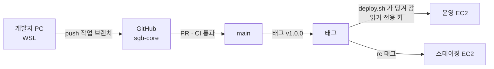

# 소개뱅크 GitHub 구성 및 적용 절차서 v1.0

Sep 25, 2026 · @박세호

## 0. 결론 요약

**GitHub 조직(Organization) `sogaebaenk` 하나를 만들고, 비공개 저장소 3개(`sgb-core` · `sgb-adx` · `sgb-ops`)를 둡니다. 요금제는 Team(사용자당 월 4달러)으로 올리고, 배포는 지금처럼 EC2가 태그를 당겨 가는 방식(`deploy.sh <태그>`)을 유지합니다.**

오늘(09-25)은 AWS 적용절차 v2.0 일정상 D-2이며, STEP 8(첫 배포)이 저장소를 전제로 합니다. 따라서 이 문서의 STEP 1\~5는 **오늘 오전 안에** 끝내야 합니다. 자동 검사(CI)와 세부 규칙은 오픈 뒤 D+1\~D+7에 붙여도 배포에 지장이 없습니다.

### 판단 근거

1. **보호 규칙은 유료 요금제에서만 비공개 저장소에 걸립니다.** 무료 조직에서는 공개 저장소만 규칙이 적용되고, 비공개 저장소는 Pro·Team·Enterprise가 필요합니다 ([GitHub 문서 — 규칙 세트](https://docs.github.com/en/repositories/configuring-branches-and-merges-in-your-repository/managing-rulesets/about-rulesets)). 무료로 두면 `main` 강제 덮어쓰기와 배포 태그 이동을 막을 방법이 없습니다.
2. **배포 단위가 git 태그입니다.** `deploy.sh v1.0.0`이 태그를 그대로 받아 가므로, 태그가 바뀌면 운영 코드가 바뀝니다. 태그 수정·삭제 금지 규칙이 필수입니다.
3. **코드가 두 패키지로 갈렸습니다.** 최신 기준은 `sgb-core_v3.0`(본체)과 `sgb-adx_v1.0`(광고 플랫폼)이고, 연동규약상 DB도 분리입니다. 저장소도 나눠야 한쪽 수정이 다른 쪽 검정을 묶지 않습니다.
4. **자동 배포는 이번에 넣지 않습니다.** 대표 1인이 운영하는 첫 오픈에서 GitHub에 서버 접속 열쇠를 맡기면 사고 범위가 커집니다. 당겨 가는 방식은 이미 AWS v2.0 §10-5·§11-3에 준비되어 있습니다.

### 전제

| 항목 | 값 | 출처 |
| --- | --- | --- |
| 기술 구성 | NestJS(api) · Next.js(web) · Vite(admin) · PostgreSQL 16 · Node 22 | AWS 적용절차 v2.0 |
| 배포 방식 | Docker 미사용 · systemd · 릴리스 폴더 + 심볼릭 링크 교체 | AWS 적용절차 v2.0 §11 |
| 첫 배포일 | 2026-09-27(일) | AWS 적용절차 v2.0 §3 |
| 개발 인원 | 1\~3명으로 가정 | ★ 확인 필요 |
| 기존 저장소 | 개발자 개인 계정에 이미 있는지 모름 | ★ 확인 필요 — 있으면 STEP 3을 '이전'으로 바꿉니다 |

## 1. 현재 상태와 기존 문서 연결

**저장소는 아직 실물이 확인되지 않았고, AWS v2.0의 STEP 7·8이 저장소 주소와 배포 키를 요구합니다.** 이 문서는 그 빈칸을 채웁니다.

| 기존 문서 · 위치 | 지금 적힌 내용 | 이 문서로 닫히는 것 |
| --- | --- | --- |
| 로컬개발절차 v1.1 §9-3 #1·#2 | 저장소 위치(GitHub/GitLab/사내) · 브랜치 전략 미결 | GitHub 조직 · `main` + 짧은 작업 브랜치 + 태그 배포로 확정 |
| AWS 적용절차 v2.0 §2 #4 | 저장소 접근 · 읽기 전용 배포 키 준비물 | STEP 6에서 발급·등록 |
| AWS 적용절차 v2.0 §10-3 | `repo.url` 예시 `sgb-integrated-kit.git` | **`git@github.com:sogaebaenk/sgb-core.git` 으로 교체** — 최신 패키지명과 일치 |
| AWS 적용절차 v2.0 §11-3 | `deploy.sh`가 `/usr/local/bin`에만 존재 | `sgb-ops` 저장소에 원본 보관 · 버전 관리 |
| AWS 적용절차 v2.0 §21-3 | 폴더명 `api/` `web/` `admin/` · 스크립트명 확인 필요 | STEP 3에서 저장소에 올리며 실물로 확인 |
| 최신본 목록 09-24 §3 | 코드 패키지 '실물 미보관 — 문서 기록 기준' | 저장소가 유일한 원본이 됨 |

### 코드가 흐르는 길



GitHub는 서버에 접속하지 않습니다. 서버가 GitHub에서 읽기만 합니다.

## 2. 선택지 비교

**세 가지 결정 모두 표의 첫 줄(★)을 권고합니다.** 다른 줄이 맞는 조건을 '이럴 때만' 칸에 적었습니다.

### 2-1. 요금제

| 선택지 | 월 비용(3명 기준) | 비공개 저장소 보호 규칙 | 이럴 때만 |
| --- | --- | --- | --- |
| ★ Team 조직 | 12달러 | `main` 보호 · 태그 보호 · 필수 검토 · 코드 담당자 지정 모두 가능 | 권고 |
| Free 조직 | 0원 | **적용 안 됨** — 규칙을 만들어도 비공개 저장소에서는 강제되지 않음 | 개발자 1명이고 오픈 전 2주만 쓸 때 |
| 개인 계정 + Pro | 4달러(소유자 1명) | 가능 | 권고하지 않음 — 개발자가 바뀌면 소유권 이전이 필요 |

조직 요금은 조직 구성원과 비공개 저장소 접근 권한을 가진 외부 협력자 수로 매겨지고, 수락 전 초대도 자리를 차지할 수 있습니다. 공식 요금표는 Team 가격을 '첫 12개월' 기준으로 표시하므로 갱신 가격은 결제 화면에서 확인해야 합니다 ([요금 정리, 2026-09 갱신](https://capitalandcompute.net/blog/github-pricing-plans-cost/)).

### 2-2. 저장소 개수

| 선택지 | 장점 | 단점 | 이럴 때만 |
| --- | --- | --- | --- |
| ★ 3개 (`sgb-core` · `sgb-adx` · `sgb-ops`) | 패키지 분리와 일치 · 배포 키를 본체에만 발급 · 서버 스크립트 이력 보존 | 저장소 관리 3곳 | 권고 |
| 2개 (`sgb-core` · `sgb-adx`) | 단순 | `deploy.sh`·Nginx 설정이 서버에만 남음 → EC2 유실 시 재구성 근거 없음 | 스크립트를 `sgb-core/ops/`에 넣기로 할 때 |
| 1개 (통합) | 가장 단순 | 광고 수정이 본체 검정 420건을 묶음 · 연동규약의 분리 원칙과 충돌 | 권고하지 않음 |

### 2-3. 배포 방식

| 선택지 | 방식 | 보안 위험 | 이럴 때만 |
| --- | --- | --- | --- |
| ★ 서버가 당겨 감 | EC2에서 `sudo deploy.sh v1.0.0` · 읽기 전용 배포 키 | 낮음 — GitHub가 뚫려도 서버 접속 불가 | 권고 · 이미 AWS v2.0에 준비됨 |
| GitHub Actions → SSH 접속 | 태그 푸시 시 Actions가 EC2에 SSH로 들어가 `deploy.sh` 실행 | 중간 — SSH 개인키를 GitHub 비밀값에 보관 · 22번 포트를 GitHub 대역에 열어야 함 | 배포가 주 3회 이상으로 늘 때 |
| GitHub Actions → AWS SSM 명령 | OIDC(열쇠 없이 임시 권한을 받는 방식)로 AWS에 로그인해 SSM으로 실행 | 낮음 — 열쇠 보관 없음 · 22번 포트 불필요 | 오픈 1개월 뒤 자동화 단계 |

## 3. 목표 구성

**조직 1 · 저장소 3 · 팀 2 · 규칙 세트 2개가 전부입니다.** 이름은 AWS v2.0의 자원 이름(`sgb-prod-…`)과 같은 접두어 `sgb-`로 맞췄습니다.

### 3-1. 조직과 저장소

| 구분 | 이름 | 공개 여부 | 내용 | 배포 키 |
| --- | --- | --- | --- | --- |
| 조직 | `sogaebaenk` | — | 소유자 2명(대표 + 예비 1명) | — |
| 저장소 | `sgb-core` | 비공개 | 본체 — `api/` `web/` `admin/` · Prisma 마이그레이션 · 검정 | 운영 1 · 스테이징 1 (읽기 전용) |
| 저장소 | `sgb-adx` | 비공개 | 광고 플랫폼 — 송출 서버 · 태그 · 연동규약 | 2차 배포 때 발급 |
| 저장소 | `sgb-ops` | 비공개 | `deploy.sh` · `rollback.sh` · systemd 유닛 · Nginx 설정 · logrotate · n8n 워크플로 내보내기 파일 | 없음 (사람이 복사) |

**비밀값(`.env`, 키, 인증서)은 어느 저장소에도 넣지 않습니다.** 비밀값의 원본은 EC2 `/etc/sogaebaenk/*.env`와 AWS Parameter Store입니다(AWS v2.0 §10-4).

### 3-2. 팀과 권한

| 팀 | 구성원 | `sgb-core` · `sgb-adx` | `sgb-ops` |
| --- | --- | --- | --- |
| 소유자(Owner) | 대표 · 예비 소유자 1명 | 관리(Admin) | 관리 |
| `dev` | 내부 개발자 | 쓰기(Write) | 읽기 |
| 외부 협력자 | 외주 · 검토 인력 | 필요한 저장소만 읽기 또는 쓰기 | 접근 없음 |

조직 기본 권한은 \*\*'권한 없음(No permission)'\*\*으로 둡니다. 새 사람이 들어오면 팀에 넣어야만 보이게 됩니다.

### 3-3. 브랜치 · 태그 · 커밋 규칙

| 대상 | 규칙 | 예시 |
| --- | --- | --- |
| `main` | 항상 배포 가능한 상태 · 직접 푸시 금지 · PR로만 합침 | — |
| 작업 브랜치 | `종류/짧은설명` · 3일 안에 합치기 | `feat/lead-billing` · `fix/payout-gate` · `chore/ci` |
| 긴급 수정 | `hotfix/설명` → PR → 합친 뒤 즉시 패치 태그 | `hotfix/footer-bizno` → `v1.0.1` |
| 스테이징 태그 | `vX.Y.Z-rc.N` | `v1.0.0-rc.1` |
| 운영 태그 | `vX.Y.Z` · 한 번 붙이면 수정·삭제 금지 | `v1.0.0` |
| 커밋 메시지 | `종류: 무엇을` · 한국어 허용 · 과제 ID 병기 | `fix: 푸터 사업자번호 표기 (L-02)` |

### 3-4. 규칙 세트(Ruleset)

| 이름 | 대상 | 켜는 항목 | 예외(우회) |
| --- | --- | --- | --- |
| `protect-main` | 기본 브랜치 | 삭제 금지 · 강제 푸시 금지 · PR 필수(승인 1) · 상태 검사 `ci` 통과 필수 · 합치기 전 최신화 필수 | 소유자만 — 긴급 시 |
| `protect-release-tags` | 태그 `v*` | 수정 금지 · 삭제 금지 · 생성은 소유자와 `dev` 팀 | 없음 |

개발자가 1명뿐이면 '승인 1'을 대표가 누르거나 0으로 둡니다. 0으로 두더라도 PR 필수와 `ci` 통과는 유지합니다.

## 4. 단계별 적용 절차

**STEP 1\~6은 오늘(09-25, D-2) AWS STEP 8 전에, STEP 7\~8은 D+1\~D+7에 합니다.** 합계 약 3\~4시간입니다.

| STEP | 내용 | 누가 | 언제 | 소요 |
| --- | --- | --- | --- | --- |
| 1 | 조직 생성 · 2단계 인증 강제 · Team 결제 | 대표 | 09-25 오전 | 20분 |
| 2 | 저장소 3개 생성 | 대표 | 09-25 오전 | 10분 |
| 3 | 코드 올리기(또는 기존 저장소 이전) | 개발 | 09-25 오전 | 30\~60분 |
| 4 | 팀 · 권한 · 초대 | 대표 | 09-25 오전 | 15분 |
| 5 | 규칙 세트 2개 | 대표 | 09-25 오전 | 20분 |
| 6 | EC2 배포 키 등록 · 연결 시험 | 대표 | 09-25 AWS STEP 8 직전 | 20분 |
| 7 | 자동 검사(CI) · 비밀값 검사 · 의존성 알림 | 개발 | D+1\~D+3 | 1\~2시간 |
| 8 | `sgb-ops`에 서버 스크립트 보관 | 대표·개발 | D+3\~D+7 | 30분 |

### STEP 1 · 조직 생성 · 2단계 인증 · 결제 (대표 · 20분)

1. 대표 개인 GitHub 계정에 로그인 → 계정 설정 › Password and authentication › **2단계 인증(2FA) 켜기**. 복구 코드를 `.pem`과 같은 두 곳에 보관합니다.
2. 우상단 `+` › **New organization** › Team 선택 › 조직 이름 `sogaebaenk` · 결제 메일은 운영용 메일(AWS와 같은 주소).
3. 조직 Settings › Authentication security › **Require two-factor authentication** 켜기.
4. 조직 Settings › Member privileges › **Base permissions = No permission** · 저장소 생성은 소유자만.
5. 예비 소유자 1명을 Owner로 초대합니다. 소유자가 1명이면 대표 계정 분실 시 조직을 되찾기 어렵습니다.

`[확인]` 조직 Settings › Billing에 Team 표시 · People 목록 전원 2FA 표시.

### STEP 2 · 저장소 3개 생성 (대표 · 10분)

조직 › Repositories › **New repository** — 세 번 반복합니다.

1. 이름 `sgb-core` · **Private** · README·.gitignore·라이선스 **모두 추가하지 않음** (빈 저장소여야 STEP 3의 첫 푸시가 충돌하지 않습니다).
2. `sgb-adx` · `sgb-ops` 같은 방식.
3. 각 저장소 Settings › General › Pull Requests: **Allow squash merging만 켜기** · Automatically delete head branches 켜기.

`[확인]` 세 저장소 모두 자물쇠(Private) 표시.

### STEP 3 · 코드 올리기 (개발 · 30\~60분)

**먼저 확인합니다: 개발자 개인 계정에 이미 저장소가 있습니까?**

- **있음** → 그 저장소 Settings › General › Danger Zone › **Transfer ownership** › `sogaebaenk`로 이전합니다. 커밋 이력이 보존됩니다. STEP 2에서 만든 같은 이름의 빈 저장소는 먼저 지웁니다.
- **없음** → 아래 명령으로 zip 패키지를 첫 커밋으로 올립니다. **WSL 안(`~/work`)에서** 실행합니다. Windows 폴더(`/mnt/c/...`)에서 하면 줄바꿈과 실행 권한이 틀어집니다.

```bash
# 1) 풀기 · 저장소 시작
mkdir -p ~/work && cd ~/work
unzip sgb-core_v3.0.zip -d sgb-core && cd sgb-core
git init -b main
git config user.name  "홍길동"
git config user.email "dev@sogaebaenk.co.kr"

# 2) 5절의 .gitignore · .gitattributes 를 먼저 넣고 확인
git add .gitignore .gitattributes
git status --ignored | head -40      # node_modules, .env, dist 가 ignored 에 있어야 함

# 3) 비밀값 검사 — 첫 커밋 전에 반드시 (gitleaks v8.19 이상 기준)
gitleaks dir . -v                    # 결과 0건이어야 진행. 이전 버전은: gitleaks detect --no-git -s . -v

# 4) 큰 파일 검사 — GitHub는 100MB 넘는 파일을 거부
find . -type f -size +50M -not -path './node_modules/*'

# 5) 첫 커밋 · 푸시
git add .
git commit -m "chore: sgb-core v3.0 패키지 기준선 (2026-09-15)"
git remote add origin git@github.com:sogaebaenk/sgb-core.git
git push -u origin main

# 6) 기준선 태그
git tag -a v0.9.0 -m "kit v3.0 기준선"
git push origin v0.9.0
```

`sgb-adx_v1.0.zip`도 같은 절차로 `sgb-adx`에 올립니다.

**이때 AWS v2.0 §21-3을 함께 닫습니다.** 올린 저장소에서 아래를 확인해 AWS 문서에 적습니다.

```bash
ls -d api web admin                              # 폴더명 실물
jq .scripts api/package.json web/package.json admin/package.json   # build · start · db:migrate 실제 이름
grep -rn "CREATE EXTENSION" api/prisma/ 2>/dev/null   # 필요한 PostgreSQL 확장
```

`[확인]` GitHub `sgb-core` 화면에 `api/` `web/` `admin/` 폴더가 보이고 `.env` 파일이 없음 · Tags에 `v0.9.0`.

### STEP 4 · 팀 · 권한 · 초대 (대표 · 15분)

1. 조직 › Teams › **New team** › `dev` 생성.
2. `dev` 팀 › Repositories › `sgb-core` · `sgb-adx` = **Write**, `sgb-ops` = **Read**.
3. 조직 › People › **Invite member** › 개발자 GitHub 아이디 → `dev` 팀 지정.
4. 외주 인력은 Member가 아니라 저장소 Settings › Collaborators에서 **해당 저장소만** 추가합니다.

`[확인]` 개발자 계정으로 로그인 시 `sgb-ops` 편집 버튼이 없음.

### STEP 5 · 규칙 세트 2개 (대표 · 20분)

`sgb-core` › Settings › Rules › Rulesets › **New branch ruleset**

1. 이름 `protect-main` · Enforcement **Active** · Target **Include default branch**.
2. Bypass list: **Organization admin** 추가(긴급 시 소유자만).
3. 켜기: Restrict deletions · Block force pushes · Require a pull request before merging(승인 1 또는 0 — 3-4 참고) · Require status checks to pass(`ci` — **STEP 7 뒤에 추가**, 지금은 비워 둠).

**New tag ruleset**

1. 이름 `protect-release-tags` · Active · Target **Include by pattern** `v*`.
2. 켜기: Restrict updates · Restrict deletions.

`sgb-adx`도 같은 두 세트를 만듭니다.

`[확인]` 개발자 PC에서 `git push origin main` 직접 푸시가 거부됨 · `git push --delete origin v0.9.0`이 거부됨.

### STEP 6 · EC2 배포 키 등록 · 연결 시험 (대표 · 20분)

AWS v2.0 §10-5를 그대로 따르되, 아래 두 가지만 바꿉니다.

1. `repo.url` 값을 `git@github.com:sogaebaenk/sgb-core.git`으로 넣습니다.
2. 공개키는 `sgb-core` › Settings › **Deploy keys** › Add deploy key · 제목 `sgb-prod-web` · **Allow write access 체크하지 않음**.

```bash
# 운영 EC2 안에서
echo 'git@github.com:sogaebaenk/sgb-core.git' | sudo tee /etc/sogaebaenk/repo.url
sudo -u sbapp git ls-remote "$(cat /etc/sogaebaenk/repo.url)" refs/tags/v0.9.0
# 해시 1줄 + refs/tags/v0.9.0 이 나오면 성공
```

스테이징 EC2(09-26)는 **별도 키를 새로 만들어** 제목 `sgb-staging-web`으로 등록합니다. 한 배포 키는 한 저장소에만 등록되며, 서버마다 키를 따로 두어야 한 대가 털려도 그 키만 지우면 됩니다.

`[확인]` 위 명령 성공 · Deploy keys 목록에 'Read-only' 표시.

### STEP 7 · 자동 검사(CI) · 비밀값 검사 · 의존성 알림 (개발 · D+1\~D+3)

1. 5절의 `.github/workflows/ci.yml`을 작업 브랜치에 추가 → PR → 초록불 확인 → 합치기.
2. STEP 5의 `protect-main`에 상태 검사 **`ci`** 추가.
3. 저장소 Settings › Code security › **Dependabot alerts** · **Dependabot security updates** 켜기(무료).
4. 5절의 `.github/dependabot.yml` 추가 — 주 1회 묶음 PR.

`[확인]` 일부러 빌드가 깨지는 PR을 올려 합치기 버튼이 막히는지 봅니다.

### STEP 8 · `sgb-ops`에 서버 스크립트 보관 (D+3\~D+7)

```bash
# 운영 EC2 에서 현재 쓰는 원본을 꺼냄 (비밀값 없는 파일만)
mkdir -p ~/sgb-ops/{bin,systemd,nginx,logrotate,n8n}
sudo cp /usr/local/bin/deploy.sh /usr/local/bin/rollback.sh ~/sgb-ops/bin/
sudo cp /etc/systemd/system/sogaebaenk-*.service ~/sgb-ops/systemd/
sudo cp /etc/nginx/sites-available/* ~/sgb-ops/nginx/
sudo cp /etc/logrotate.d/sogaebaenk ~/sgb-ops/logrotate/
sudo chown -R $USER ~/sgb-ops
```

이 폴더를 개발자 PC로 옮겨 `sgb-ops`에 커밋합니다. **`/etc/sogaebaenk/*.env`는 절대 복사하지 않습니다.** n8n 워크플로는 n8n 화면에서 JSON으로 내보낸 뒤, 자격증명(credentials)이 빠졌는지 확인하고 `n8n/`에 넣습니다.

## 5. 저장소에 넣을 설정 파일

**`sgb-core` 기준 5개 파일입니다.** 폴더명(`api/` `web/` `admin/`)과 스크립트명(`build` `test` `db:migrate`)은 AWS v2.0 §21-3의 추정값이므로, STEP 3에서 확인한 실물로 바꿔 씁니다.

```
sgb-core/
├─ .gitignore
├─ .gitattributes
├─ .github/
│   ├─ workflows/ci.yml
│   ├─ dependabot.yml
│   └─ pull_request_template.md
├─ api/   web/   admin/
└─ .env.example        ← 변수 이름만, 값은 비움
```

### 5-1. `.gitignore`

```gitignore
# 의존성 · 빌드 산출물
node_modules/
dist/
.next/
out/
coverage/

# 비밀값 — .env.example 만 커밋
.env
.env.*
!.env.example
*.pem
*.key

# 로그 · 업로드 · OS 파일
*.log
uploads/
.DS_Store
Thumbs.db

# 편집기
.idea/
.vscode/*
!.vscode/extensions.json
```

### 5-2. `.gitattributes` — 줄바꿈을 리눅스 방식으로 고정

```gitattributes
* text=auto eol=lf
*.sh text eol=lf
*.png binary
*.jpg binary
*.pdf binary
```

Windows에서 편집한 `deploy.sh`가 `\r` 때문에 서버에서 실행되지 않는 사고를 막습니다.

### 5-3. `.github/workflows/ci.yml` — 상태 검사 이름 `ci`

```yaml
name: ci
on:
  pull_request:
  push:
    branches: [main]

jobs:
  ci:                      # 이 이름이 규칙 세트의 상태 검사 이름이 됩니다
    runs-on: ubuntu-24.04
    timeout-minutes: 20
    services:
      postgres:
        image: postgres:16
        env:
          POSTGRES_USER: ci
          POSTGRES_PASSWORD: ci
          POSTGRES_DB: sgb_ci
        ports: ["5432:5432"]
        options: >-
          --health-cmd "pg_isready -U ci" --health-interval 5s --health-retries 10
    env:
      DATABASE_URL: postgresql://ci:ci@localhost:5432/sgb_ci?schema=public
      TZ: UTC
      SEED_DEV: "0"
    steps:
      - uses: actions/checkout@v5
        with:
          fetch-depth: 0            # 비밀값 검사가 전체 이력을 봄

      - name: 비밀값 검사
        run: docker run --rm -v "$PWD:/repo" zricethezav/gitleaks:latest git /repo -v

      - uses: actions/setup-node@v5
        with:
          node-version: 22

      # ★ 폴더명 · 스크립트명은 저장소 실물로 교체
      - name: api 빌드 · 마이그레이션 · 시험
        working-directory: api
        run: |
          npm ci --no-audit --no-fund
          npm run build
          npm run db:migrate
          npm test --if-present

      - name: web 빌드
        working-directory: web
        env:
          NEXT_PUBLIC_API_BASE: https://api.sogaebaenk.co.kr
        run: |
          npm ci --no-audit --no-fund
          npm run build

      - name: admin 빌드
        working-directory: admin
        env:
          VITE_API_BASE: https://api.sogaebaenk.co.kr
        run: |
          npm ci --no-audit --no-fund
          npm run build
```

빈 PostgreSQL 16에 마이그레이션을 매번 처음부터 적용하므로, 운영 배포 전에 마이그레이션 오류를 잡습니다. 저장소에 기존 검정 스크립트(검정 420건)가 있으면 `api` 단계 끝에 추가합니다.

### 5-4. `.github/dependabot.yml`

```yaml
version: 2
updates:
  - package-ecosystem: npm
    directories: ["/api", "/web", "/admin"]
    schedule: { interval: weekly, day: monday }
    groups:
      all-minor-patch:
        update-types: ["minor", "patch"]
    open-pull-requests-limit: 5
  - package-ecosystem: github-actions
    directory: "/"
    schedule: { interval: monthly }
```

### 5-5. `.github/pull_request_template.md`

```markdown
## 무엇을 바꿨나
- 과제 ID:
- 화면 ID (SB-…):

## 확인
- [ ] 로컬에서 빌드 · 마이그레이션 통과
- [ ] 마이그레이션은 추가만 (기존 컬럼 삭제 · 이름 변경 없음)
- [ ] .env · 키 · 개인정보 샘플 없음
- [ ] 라우트 추가 시 라우트 등록표 7체계 v4.0 갱신
```

마이그레이션 '추가만' 항목은 AWS v2.0 §21-5의 전진 전용 원칙을 PR마다 확인하려는 장치입니다.

## 6. 비용과 필요 자원

**3명 기준 월 12달러(환율 1,400원 가정 시 약 1만 7천원)이며, 자동 검사 시간은 무료 한도 안에 들어옵니다.** 가격은 변동 정보이므로 결제 화면에서 다시 확인합니다.

| 항목 | 단가 | 소개뱅크 예상 | 월 비용 |
| --- | --- | --- | --- |
| Team 좌석 | 사용자당 월 4달러(첫 12개월 표기) | 대표 + 예비 소유자 + 개발 1명 = 3석 | 12달러 |
| Actions 실행 시간 | Team 포함 월 3,000분 · 초과 시 리눅스 분당 0.006달러 | 1회 약 8분 × 월 40회 ≈ 320분 | 0원 |
| 비밀값 자동 차단(Secret Protection) | 커미터당 월 19달러 | 구매 안 함 — gitleaks로 대체 | 0원 |
| Dependabot 알림 | 무료 | 사용 | 0원 |

출처: [요금 정리(2026-09 갱신)](https://capitalandcompute.net/blog/github-pricing-plans-cost/) · [Actions 단가(2026-08)](https://cicdcalculator.com/github-actions) · [부가 보안 상품 단가(2026-03)](https://checkthat.ai/brands/github/pricing). 1회 8분 · 월 40회는 추정값입니다.

**좌석 비용 절감 요령:** 퇴사자와 수락하지 않은 초대는 바로 지웁니다. 둘 다 좌석으로 잡힐 수 있습니다.

### 필요 자원

| 자원 | 누가 준비 | 없으면 |
| --- | --- | --- |
| 법인카드(해외 결제 가능) | 대표 | Team 결제 불가 |
| 운영용 메일(AWS와 동일) | 대표 | 결제 · 보안 알림 누락 |
| 대표 · 예비 소유자 GitHub 계정 + 인증 앱 | 대표 | 2FA 강제 시 접근 차단 |
| 개발자 GitHub 아이디 | 개발 | STEP 4 초대 불가 |
| `sgb-core_v3.0.zip` · `sgb-adx_v1.0.zip` 실물 또는 기존 저장소 주소 | 개발 | **STEP 3 불가 → AWS STEP 8 불가** |
| 운영 EC2 접속(AWS STEP 4 완료) | 대표 | STEP 6 불가 |

## 7. 발생 가능한 문제와 해결

**가장 치명적인 것은 1번(비밀값 커밋)과 2번(코드 실물 부재)입니다.** 둘 다 오늘 배포 일정을 바로 멈춥니다.

| # | 증상 | 원인 | 해결 |
| --- | --- | --- | --- |
| 1 | `.env`나 키가 커밋·푸시됨 | `.gitignore`보다 먼저 `git add .` | **파일을 지우는 것으로는 부족합니다.** 그 키를 즉시 폐기·재발급(JWT 비밀값 · DB 비밀번호 · 외부 API 키) → 이력에서 제거 후 강제 푸시(소유자 우회) → Parameter Store 갱신. 첫 커밋 전 `gitleaks`가 이것을 막는 장치입니다 |
| 2 | zip 실물이 없음 | 최신본 목록 09-24 §3 '실물 미보관' | 개발자에게 오늘 오전 원본 요청. 없으면 AWS STEP 8을 하루 미루고 GO/NO-GO에 반영 |
| 3 | EC2에서 `Permission denied (publickey)` | 배포 키 미등록 · `sbapp`의 ssh 설정 경로 오류 | `sudo -u sbapp ssh -T git@github.com` 으로 확인 → 인사 문구가 나오면 키는 정상, 저장소 권한 확인 |
| 4 | EC2에서 github.com 22번 연결 시간 초과 | 네트워크가 22번 밖으로 막힘 | ssh 설정에 `Hostname ssh.github.com` · `Port 443` 추가 |
| 5 | 배포 키 등록 시 'Key is already in use' | 같은 공개키를 다른 저장소에 이미 등록 | 서버·저장소마다 키를 새로 생성 |
| 6 | 첫 푸시가 거부됨(`rejected`) | STEP 2에서 README를 만들어 이력 충돌 | 빈 저장소로 다시 만들거나 `git pull --rebase origin main` 후 푸시 |
| 7 | 100MB 초과 파일로 푸시 거부 | 프로토타입 동영상 · 덤프 파일 포함 | 저장소에서 빼고 S3에 보관. 이미 커밋했으면 이력에서 제거 |
| 8 | 서버에서 `deploy.sh: /bin/bash^M` 오류 | Windows 줄바꿈 | `.gitattributes`(5-2) 적용 · `sed -i 's/\r$//' deploy.sh` |
| 9 | 규칙을 만들었는데 직접 푸시가 됨 | Free 요금제 · 또는 본인이 우회 목록(소유자) | 결제 상태 확인 · 개발자 계정으로 시험 |
| 10 | `ci`가 규칙 세트 상태 검사 목록에 안 보임 | 워크플로가 한 번도 실행되지 않음 | PR 하나를 올려 1회 실행 후 추가 |
| 11 | 태그를 잘못 붙였는데 지울 수 없음 | 태그 보호 규칙(의도된 동작) | 지우지 말고 다음 번호로 새 태그(`v1.0.1`). 운영 태그는 되돌리지 않는 것이 원칙 |
| 12 | 개발자 퇴사 후에도 접근 가능 | 개인 PC에 clone · 팀에서 미제거 | 조직에서 제거 · 해당 인원이 알던 비밀값 교체 · 배포 키는 서버 소유라 유지 |

## 8. 현장 체크리스트

**'오늘' 8개가 모두 체크되어야 AWS STEP 8(첫 배포)을 시작합니다.**

### 오늘(09-25) — AWS STEP 8 전

- [ ] 대표 계정 2FA 켜짐 · 복구 코드 2곳 보관
- [ ] 조직 `sogaebaenk` Team 결제 완료 · 조직 2FA 강제
- [ ] 소유자 2명 · 기본 권한 'No permission'
- [ ] `sgb-core` · `sgb-adx` · `sgb-ops` 비공개로 생성
- [ ] `sgb-core`에 코드 푸시 · `.env` 없음 · gitleaks 0건 · 태그 `v0.9.0`
- [ ] `protect-main` · `protect-release-tags` 활성 · 개발자 계정으로 직접 푸시 거부 확인
- [ ] 운영 EC2 `repo.url` = `sogaebaenk/sgb-core` · 배포 키 읽기 전용 · `git ls-remote` 성공
- [ ] AWS v2.0 §21-3(폴더명 · 스크립트명 · 확장) 실물로 기입

### 09-26 — 스테이징 · GO/NO-GO

- [ ] 스테이징 EC2 전용 배포 키 별도 등록
- [ ] 푸터 법정고지 반영 커밋이 PR로 `main`에 합쳐짐
- [ ] `v1.0.0-rc.1` 태그로 스테이징 배포 성공
- [ ] 운영 태그 `v1.0.0`은 GO 판정 뒤에만 생성

### D+1\~D+7

- [ ] `ci` 워크플로 초록불 · `protect-main`에 상태 검사 추가
- [ ] Dependabot 알림 · 보안 업데이트 켜짐
- [ ] `sgb-ops`에 `deploy.sh` · `rollback.sh` · systemd · Nginx · logrotate 커밋 · `.env` 없음
- [ ] n8n 워크플로 JSON 내보내기 · 자격증명 제외 확인 후 커밋
- [ ] 좌석 목록 점검 — 불필요한 초대 · 외부 협력자 제거

## 9. 확인 필요 사항과 다음 할 일

**1\~3번은 오늘 오전 개발자 답변이 있어야 STEP 3이 시작됩니다.**

| # | 확인할 것 | 영향 | 누가 |
| --- | --- | --- | --- |
| 1 | 코드가 이미 개인 GitHub 저장소에 있는지 · 있으면 주소 | STEP 3 '이전' 또는 '새로 올리기' | 개발 |
| 2 | `sgb-core_v3.0.zip` · `sgb-adx_v1.0.zip` 실물 위치 | STEP 3 · AWS STEP 8 | 개발 |
| 3 | 개발 인원 수와 GitHub 아이디 | 좌석 수 · 승인 1/0 결정 | 대표·개발 |
| 4 | 저장소가 한 폴더에 `package-lock.json` 하나인지(작업공간 방식), 폴더마다 따로인지 | `ci.yml` · `deploy.sh`의 `npm ci` 위치 | 개발 |
| 5 | 기존 검정 420건 실행 명령 | `ci.yml`에 추가 | 개발 |
| 6 | 예비 소유자로 누구를 둘지 | STEP 1-5 | 대표 |
| 7 | Team 결제 화면의 실제 가격 · 갱신 조건 | 6절 비용 | 대표 |

### 바로 할 일

1. 개발자에게 1\~3번을 지금 묻습니다.
2. 답을 기다리는 동안 STEP 1 · 2를 진행합니다(대표 30분).
3. 이 문서가 확정되면 AWS 적용절차 v2.0 §10-3의 `repo.url` 예시를 `sogaebaenk/sgb-core`로 고치고, 최신본 목록에 이 문서를 등재합니다.

## 출처

- [GitHub 문서 — 규칙 세트 정보](https://docs.github.com/en/repositories/configuring-branches-and-merges-in-your-repository/managing-rulesets/about-rulesets) · 비공개 저장소 규칙 적용 요금제
- [GitHub 문서 — 브랜치 보호 규칙 관리](https://docs.github.com/en/repositories/configuring-branches-and-merges-in-your-repository/managing-protected-branches/managing-a-branch-protection-rule)
- [GitHub 요금 정리(Capital & Compute, 2026-09-25 갱신)](https://capitalandcompute.net/blog/github-pricing-plans-cost/) · 좌석 산정 · 첫 12개월 표기
- [GitHub Actions 요금(CICDCalculator, 2026-08)](https://cicdcalculator.com/github-actions) · 포함 시간 · 초과 단가
- [GitHub 부가 보안 상품 요금(checkthat.ai, 2026-03)](https://checkthat.ai/brands/github/pricing)
- 프로젝트 문서: AWS 적용절차 v2.0 · 로컬개발절차 v1.1 · 최신본 목록 20260924 · 광고플랫폼 분리 v1.0 · 광고플랫폼 연동규약 v1.0
