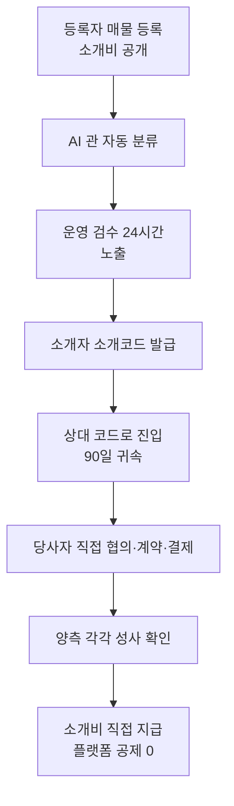

# 소개뱅크 서비스 구조 정리 v1.0

Sep 24, 2026 · @박세호

## 결론

소개뱅크는 **사업자가 소개비를 공개로 걸어두면, 소개자가 소개코드로 상대를 연결하고, 거래와 소개비 지급은 당사자끼리 직접 하는 플랫폼**입니다. 그 위에 건강몰(판매)·광고 네트워크·제휴 파트너센터가 **서로 섞이지 않는 별도 체계**로 붙어 있습니다.

| 질문 | 한 줄 답 |
| --- | --- |
| ① 누가 쓰는가 | 소개형은 **사업자만**, 건강몰은 **소비자도**, 광고는 광고주·퍼블리셔, 제휴는 파트너 |
| ② 무엇을 거래하는가 | 고정자산이 넘어가는지로 관을 가름 — 물품·용역 / 부동산·설비 / 사업 통째 / 상담 리드 / 건강상품 |
| ③ 왜 반복해서 오는가 | 소개자는 \*\*"누구를 연결하면 얼마 받나"\*\*가 보여서, 등록자는 소개자 네트워크를 영업 인력처럼 쓰려고 |
| ④ 거래가 어떻게 발생하는가 | 등록 → 검수 → 소개코드 → 90일 귀속 → 당사자 직접 계약 → 양측 성사 확인 → 소개비 직접 지급 |

**플랫폼 매출은 거래 규모와 무관합니다.** 3억 상가가 소개로 팔려도 소개 거래에서 받는 돈은 두 회원의 구독료(198,000원)뿐입니다. 판매·광고에서만 거래액에 비례해 법니다.

이 문서는 통합설계서 v10(2026-09-15)과 이후 결정(파트너센터 2026-09-22)을 기준으로 합니다. 확정·미결 구분은 「소개뱅크 현행 확정표 v1.0」을 따릅니다.

## ① 누가 쓰는가

사용자는 체계에 따라 다릅니다. **1차 핵심 사용자는 소개자**입니다.

| 체계 | 사용자 | 하는 일 | 자격 |
| --- | --- | --- | --- |
| 소개형 | **등록자** | 팝니다(SELL)·구합니다(BUY) 등록, 소개비 금액 공개 | 사업자 (A-00R2) |
| 소개형 | **소개자** | 짝을 찾아 소개코드 발급, 성사 시 소개비 수령 | 사업자 |
| 소개형 | **소개받는 상대** | 코드로 들어와 등록자와 직접 계약 | 사업자 |
| 소개형(리드관) | **리드 수령 사업자** | 소비자 상담 신청을 독점 배분받음 | 사업자 |
| 판매형 | **소비자** | 건강몰에서 상품 구매 | 개인 가능 |
| 판매형 | **운영사 · 브랜드 · 입점사** | 직판 · 공식 직영관 · 입점 판매 | 사업자 |
| 광고 | **광고주** | 캠페인 등록, 예산 선충전 | 사업자 |
| 광고 | **퍼블리셔** | 자기 사이트에 광고 게재, 수익 배분 수령 | 개인 가능 (원천징수 3.3% 검토 중) |
| 제휴 | **파트너** | 제휴상품 링크 배포, 건당 정액 수수료 | BO 입점 심사 통과자 |
| 운영 | **운영자(BO)** | 관별 검수 · 심사 · 정산 | 관별 배정 |

**주의할 점 2가지:**

1. 개인이 **소개자**가 되는 것은 아직 막혀 있습니다. 법무 질의 A-09(직업소개사업 등록 의무) 회신 뒤 재결정합니다.
2. 운영자 관 배정이 아직 실행되지 않아, 지금은 모든 운영자가 전 관을 봅니다.

## ② 무엇을 거래하는가

소개형 3관은 **"고정자산이 넘어가는가"(A-01)** 한 가지 기준으로 나뉩니다. 사용자가 관을 고르지 않고, 한 줄 입력을 AI가 자동 분류합니다.

| 관 | 거래 대상 | 예 |
| --- | --- | --- |
| MNY 소개머니 | 고정자산이 **안** 넘어감 | 물품 · 용역 · 납품 · 산지 직거래 |
| MAL 소개몰 | **고정자산 자체** | 상가 · 공장 · 기계 · 차량 · 인테리어 |
| BIZ 소개창업 | **사업이 통째로** | 가맹 · 사업승계 · 창업부지 · 투자 매칭 |
| LED 소개리드 | 소비자 상담 신청 | 이사 · 청소 · 보험 · 의료 등 |
| HLT 건강몰 | 상품 판매 | 건강기능식품 · 일반식품 · 화장품 (의료기기는 광고만) |
| ADS 광고 | 광고 노출 · 클릭 | 내부 지면 · 외부 퍼블리셔 사이트 |
| 제휴 | 제휴상품 판매 연결 | 파트너 링크 경유 주문 |

### 플랫폼이 실제로 파는 것

소개 거래에서 플랫폼이 파는 것은 \*\*거래가 아니라 "자리와 소개코드"\*\*입니다.

| 체계 | 파는 것 | 단가 |
| --- | --- | --- |
| 소개형 | 월 구독 | BASIC 0원 / STANDARD 49,000원 / PRO 149,000원 |
| 소개형 | 초과 소개코드 | 건당 30,000원 |
| 소개형 | 노출료 · 리드 확인비용 | 리드 확인비용은 미결 (확정표 D2) |
| 판매형 | 상품 판매수수료 | 요율 추가 확인 필요 |
| 광고 | 내부 지면 / 외부 클릭 | 정액(기간) / CPC |

## ③ 왜 반복해서 오는가

재방문의 핵심은 **소개자가 "새 짝이 떴는가"를 확인하러 오는 것**입니다. 아래는 설계상의 이유이며, 오픈 전이라 실측값은 없습니다.

| 사용자 | 다시 오는 이유 | 받쳐 주는 장치 |
| --- | --- | --- |
| 소개자 | "누구를 연결하면 얼마 받나"가 목록에 공개됨 | 소개비 공개 표시 (A-12) |
| 소개자 | 양쪽이 모두 소개비를 걸면 **두 번 받음** | SELL↔BUY 짝 매칭 |
| 소개자 | 연결한 상대를 가로채이지 않음 | 90일 귀속 (INV-2) |
| 소개자 | 구독에 포함된 코드를 소진하려 함 | PRO 월 15건 포함 |
| 등록자 | 구독 기간 내 계속 노출, 소개자를 영업 인력처럼 사용 | 구독제 · 검수 24시간 |
| 리드 수령 사업자 | 경쟁 없이 독점으로 받는 리드 | 1리드 = 1사업자 (INV-L1\~L3) |
| 소비자 | 건강상품은 소모품이라 재구매 | 건강몰 |
| 파트너 | 링크당 수수료, 목표 달성률 | 파트너센터 대시보드 |
| 광고주 | 클릭 성과 | CPC 과금 |

### 약점 3가지

1. **B2B 큰 거래는 빈도가 낮습니다.** 거래 자체로는 재방문이 잘 생기지 않습니다. 그래서 첫 화면을 "인기 상품"이 아닌 **「짝」 화면**으로 바꾸자는 제안이 있습니다(확정표 D6). 이를 위해 등록 데이터에 `side`(SELL/BUY) 값이 먼저 필요합니다.
2. **공급이 먼저 있어야 짝이 생깁니다.** 콜드스타트로 사업자 20개사를 먼저 확보해야 합니다.
3. **리드관 수익성이 불확실합니다.** 일반 업종 확인비용은 800원대, 손익분기는 2,209원입니다. 보험·의료는 법무상 건당 유상 제공이 막혀 있습니다.

## ④ 거래가 어떻게 발생하는가

소개 거래는 **7단계**를 거치며, 마지막 소개비 지급은 플랫폼을 거치지 않습니다.

예: 3억 상가, 소개비 300만원. 매도인(STANDARD 49,000원)과 소개자(PRO 149,000원)의 구독료 198,000원이 플랫폼 매출이고, 300만원은 매도인이 소개자에게 직접 줍니다.

### 체계별 돈의 흐름

| 돈 | 흐름 | 플랫폼 경유 | 성사 확인 방식 |
| --- | --- | --- | --- |
| 소개비 | 등록자 → 소개자 직접 | **없음** | 사람이 양측 확인 |
| 구독 · 코드 | 회원 → 소개뱅크 (Toss 자동결제) | 있음 | — |
| 건강몰 대금 | 소비자 → PG → 대표가맹점 → 에스크로 → 구매확정 후 판매자 | 있음 | 결제로 자동 |
| 광고비 | 광고주 예치 → 클릭 시 보류 7일 → 퍼블리셔 / 소개뱅크 배분 | 있음 | 클릭 집계 |
| 제휴 수수료 | 소개뱅크 → 파트너 (트랙별 분리 정산) | 회사 비용 | 72시간 마지막 클릭 |

판매·광고에서 회사가 남의 돈을 보관하게 되어 **전자금융업 등록 의무 여부**가 최상위 위험입니다. 회신에 따라 위 표의 건강몰·광고 흐름이 바뀔 수 있습니다.

## 미결 사항과 근거 문서

①\~④ 중 아직 정해지지 않아 이 문서가 바뀔 수 있는 곳은 4곳입니다. 결정은 「소개뱅크 현행 확정표 v1.0」에서 받습니다.

| 이 문서의 위치 | 미결 내용 | 확정표 번호 |
| --- | --- | --- |
| ① 누가 | 개인 소개자 허용 | D5 (A-09 회신 후) |
| ② 무엇을 | 리드관 건당 확인비용 유지 여부 | D2 |
| ③ 왜 | 첫 화면을 「짝」 화면으로 | D6 |
| ④ 어떻게 | 건강몰·광고 자금 흐름 (전자금융업 등록 의무) | 관문 R-1\~R-3 |

### 근거 문서

- 통합설계서 v10 (2026-09-15) — 체계 셋, 확정·개정·폐기 사항, 자금 구조
- 7체계 재편 전수재검정 v1.0 (2026-09-15) — 코드상 체계 구분
- 수익구조 문답 v1.0 (2026-09-09) — 거래 예시, 짝 화면 제안 (자금 부분은 v10으로 대체됨)
- 소개몰·소개창업 관페이지 정의서 v1.0 — `side` 필드 계획
- 진행사항보고서 v1.1 (2026-09-06) — 리드관 손익분기
- 파트너센터 재설계 결정 기록 (2026-09-22)
