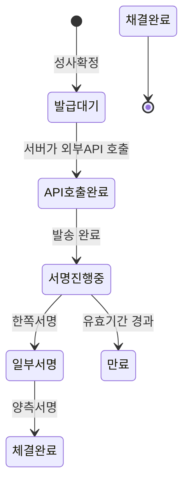
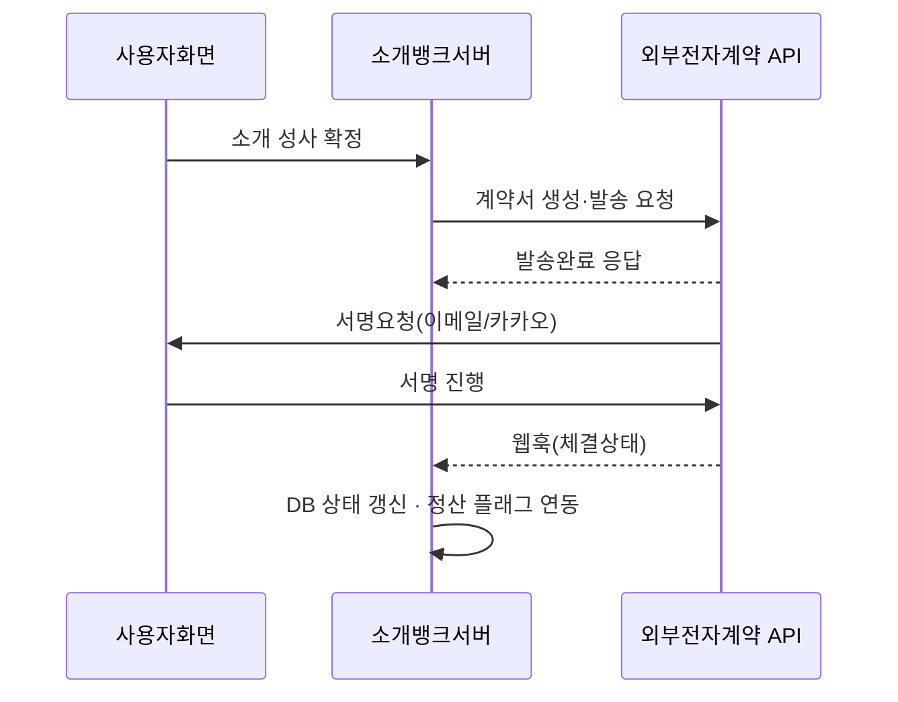

# 소개뱅크 표준계약서 양식(골격) v1.0

> Multi-tab Claude Docs export. Tabs (in order): 소개뱅크 표준계약서 양식(골격) v1.0 | 계약 시스템 적용 설계


---

<!-- TAB: 소개뱅크 표준계약서 양식(골격) v1.0 -->

# 소개뱅크 표준계약서 양식(골격) v1.0

Sep 18, 2026 · @박세호

본 문서는 B-06(계약서 양식 제공) 법무 회신 전, 표준계약서에 들어갈 조항 골격만 정리한 것이며 문구는 확정이 아니다.

## 0. 개요

- **목적**: 소개뱅크가 소개머니 영역에서 당사자 간 거래 성사 시 제공하는 표준 계약서의 조항 골격을 정한다.
- **적용범위**: 소개머니(물품·용역) 거래. 소개몰 입점계약, 부동산 관련 계약은 별도 양식(7장 참조).
- **전제**: 본 골격은 B-06(계약서 양식 제공) 법무 회신 전 단계의 초안이다. 조항 존재 여부는 확정이나, **문구는 회신 후 확정**한다.
- **설계 원칙**: 양식은 빈칸 채우기형으로 고정하고 조항 자체는 편집 불가로 잠근다 — 개별 수정이 들어가면 변호사법 제109조(비변호사의 법률사무 취급) 리스크가 생기기 때문.

## 1. 당사자 정보

| 항목 | 입력 주체 | 비고 |
| --- | --- | --- |
| 상호(사업자명) | 양측 | 자기신고값 — 계좌인증·PASS 미연동 |
| 대표자명 | 양측 |  |
| 사업자등록번호 | 양측 |  |
| 사업장 주소 | 양측 |  |
| 연락처(전화·이메일) | 양측 |  |
| 역할 구분 | 시스템 | 소개자 / 의뢰인 자동 태깅 |

입력값은 회원가입 시 등록된 사업자 정보를 자동으로 불러오고, 계약서 상에서는 수정 불가로 고정한다.

## 2. 거래목적물

| 항목 | 내용 |
| --- | --- |
| 목적물 유형 | 물품 / 용역 (소개머니 카테고리와 연동) |
| 목적물 상세 | 자유 기재란 (품명·규격·수량 또는 용역 범위) |
| 거래금액 | 자유 기재란 |
| 이행 기한·장소 | 자유 기재란 |

목적물 유형이 "용역"이고 상대방이 비사업자 개인으로 확인되는 경우, 등록 단계에서 차단되어야 한다 (A-09 법무 회신 연동 — 유료직업소개사업 등록 의무 경계).

## 3. 소개비 조건

| 항목 | 내용 |
| --- | --- |
| 소개비 금액·산정방식 | 당사자 협의 기재 |
| 지급 시점 | 성사 확정 후 자유 기재 |
| 지급 방법 | 당사자 간 직접 지급 — **플랫폼 계좌 비경유** 원칙 반영 |
| 소개자 정보 | 소개코드로부터 자동 삽입 |

소개비가 플랫폼 지갑을 경유하지 않는 현재 설계(B-15)와 일치시켜, 계약서에도 "플랫폼은 대금 흐름에 관여하지 않는다"는 문구를 넣어야 하는지는 B-15 회신과 함께 확정한다.

## 4. 플랫폼 비당사자 명시

- **조항 존재는 확정** — "본 계약은 당사자 간 계약이며, 소개뱅크는 본 계약의 당사자가 아니고 계약 내용의 이행·불이행에 대해 책임지지 않는다"는 취지의 조항을 반드시 포함한다.
- **문구는 TBD** — 정확한 표현, 면책 범위, 약관 면책 조항과의 관계는 B-06 질의3 회신에 따라 확정한다.
- 회신 전까지는 계약서 하단에 "\[본 조항은 법무 검토 대기 중이며 확정 문구로 대체 예정\]" placeholder를 노출한다.

## 5. 전자서명·본인인증

| 항목 | 내용 |
| --- | --- |
| 서명 실행 주체 | 외부 전자계약 API (이폼사인 또는 모두싸인 — 초기엔 이폼사인 권장) |
| 본인인증 수준 | 이메일·휴대폰 인증 (연동 업체 제공 기능 그대로 사용) |
| 원본 보관 | 연동 업체 서버 원본 + 소개뱅크 DB에 체결 상태·메타데이터 저장 |
| 트리거 시점 | 소개 성사 확정(정산 확정) 시점에 서버가 API 호출 |

소개뱅크가 직접 서명 엔진을 개발하지 않고 API로 위임함으로써, 본인확인·타임스탬프·원본보관 요건(B-06 질의2)을 자체 개발 없이 충족한다.

## 6. 분쟁해결

- 관할법원: 자유 기재(민사소송법 일반원칙에 따름)
- 소개뱅크는 분쟁 처리에 관여하지 않으며, 당사자 간 직접 해결을 원칙으로 한다는 문구 포함
- 준거법: 대한민국 법

## 7. 영역별 분기

| 영역 | 표준계약서 적용 | 비고 |
| --- | --- | --- |
| 소개머니(물품·용역) | 본 골격 그대로 적용 |  |
| 소개몰(입점 판매) | 별도 입점계약 양식 필요 | 판매자-플랫폼 간 계약이라 성격이 다름 |
| 부동산·상가 | 보류 | A-07(중개업 저촉) 회신 전까지 계약서 자체를 열 수 없음 |

## 8. 확정 대기 항목(TBD)

| 조항 | 미확정 내용 | 연동 법무 질의 |
| --- | --- | --- |
| 4장 비당사자 명시 | 정확한 문구·면책 범위 | B-06 질의3 |
| 0장 양식 제공 자체 | 변호사법 109조 저촉 여부 | B-06 질의1 |
| 5장 전자서명 | 증거력 요건 상세(본인확인 수준) | B-06 질의2 |
| 3장 소개비 지급 | 플랫폼 비경유 문구 필요 여부 | B-15 |
| 7장 부동산 | 계약서 개방 여부 자체 | A-07 |

회신 희망일: 2026-09-26. 회신 후 본 문서의 각 TBD 행을 확정 문구로 교체한다.


---

<!-- TAB: 계약 시스템 적용 설계 -->

# 계약 시스템 적용 설계

표준계약서 양식(골격) v1.0을 소개뱅크 시스템에 적용하는 화면, 상태, DB, API 연동 설계.

## 1. 신규 화면 목록

| 화면 ID(제안) | 화면 | 경로 | 누가 |
| --- | --- | --- | --- |
| SB-HOM-CTR-010 | 계약서 발급 신청 | 성사 확정 후 자동 진입 | 소개자/의뢰인 양측 |
| SB-HOM-CTR-020 | 계약서 상세 · 서명 진행 | /my/contracts/{id} | 서명 대기 당사자 |
| SB-HOM-CTR-030 | 계약 체결완료 목록 · 다운로드 | /my/contracts | 양측 |
| SB-ADM-CTR-010 | 계약 현황 모니터링(BO) | BO 「계약」 | 운영 |

기존 정산 화면(성사 확정 파이프라인)에 "계약서 발급" 버튼을 추가하는 형태로, 새 화면을 최소화한다.

## 2. 계약 상태 기계



| 상태 | 뜻 | 트리거 |
| --- | --- | --- |
| 발급대기 | 계약서 생성 대기 | 성사확정(정산확정) |
| API호출완료 | 외부 전자계약 API 호출 완료 | 서버 트리거 |
| 체결완료 | 양측 서명 완료 | 웹훅 수신 |
| 만료 | 유효기간 내 미서명 | 타이머 |

## 3. 처리 흐름



체결완료 웹훅을 받으면 계약 상태를 갱신하고, 필요시 정산 개시 플래그와 연결한다(B-15 회신 이후 확정).

## 4. DB 스키마 제안

```sql
CREATE TABLE contracts (
  id                bigserial PRIMARY KEY,
  deal_id           bigint NOT NULL,          -- 성사 대상(소개자·의뢰인 연결)
  template_version  text NOT NULL,            -- 표준계약서 양식 버전
  external_doc_id   text,                     -- 외부API 문서 ID
  status            text NOT NULL,            -- 발급대기·API호출완료·서명진행중·체결완료·만료
  requested_at      timestamptz NOT NULL DEFAULT now(),
  completed_at      timestamptz,
  document_url      text                      -- 체결본 다운로드 링크(외부 제공)
);

CREATE TABLE contract_events (
  id            bigserial PRIMARY KEY,
  contract_id   bigint NOT NULL REFERENCES contracts(id),
  event_type    text NOT NULL,               -- SENT, SIGNED_ONE, SIGNED_ALL, EXPIRED
  payload       jsonb,                        -- 웹훅 원본 보관(감사용)
  received_at   timestamptz NOT NULL DEFAULT now()
);
```

원본 문서는 외부 업체 서버가 보관하고, 소개뱅크 DB에는 상태·메타데이터·원본 링크만 저장한다(정산·분쟁대응용).

## 5. 우선순위 및 선행조건

| 순서 | 항목 | 상태 |
| --- | --- | --- |
| 1 | B-06 법무 회신 대기 | 2026-09-26 희망 — 비당사자 명시 문구 확정 전까지 화면 문구는 placeholder |
| 2 | 외부 API 업체 선정 | 이폼사인(API 무료) 우선 검토, 물량 증가 시 모두싸인 전환 |
| 3 | 신규 화면 4종 개발 | SB-HOM-CTR-010/020/030, SB-ADM-CTR-010 |
| 4 | 웹훅 수신 엔드포인트 구축 | 체결상태 → DB 반영 |
| 5 | 정산 플래그 연동 | B-15(에스크로·원천징수) 회신 이후 확정 |

**현재 단계에서 바로 착수 가능한 것**은 화면 설계와 DB 스키마 초안뿐이며, 실제 개발은 B-06 회신 후 비당사자 명시 문구가 확정되면 시작한다.
